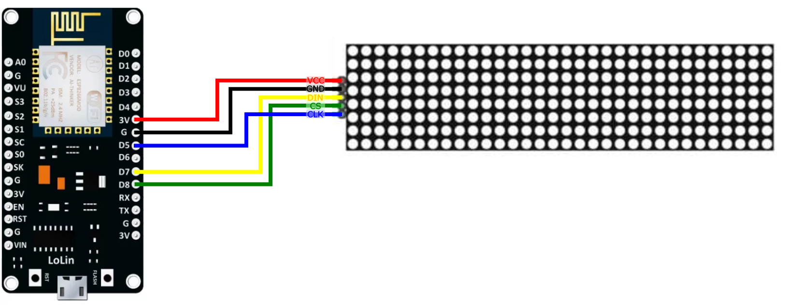

# AION
 Arduino day counter using an ESP nodemcu and a LED matrix.
 
 ## Prerequisites
 * NodeMCU V3 development board
 * MAX7219 dot LED matrix 8x32 
 * Arduino development environment
 * WiFi internet network available
 
 ## How to use AION

1. Connect the LED matrix to the NodeMCU board as described in the image below.

2. Upload the code to the NodeMCU development board via Arduino IDE.
3. Once the code is uploaded on the board, connect to the board's `DATE_TIMER` WiFi network and open http://192.168.4.4 in your browser. The instructions are also displayed on the LED matrix.

   Please note that the program will wait 3 minutes for the user to connect to the board via WiFi, before trying to automatically connect to the internet. The user can restart the state by pressing reset.

4. Once connected to the board, fill in the credentials to the wifi used to connect to internet, and the desired date to which AION should countdown, then click Save. 
5. AION will now use the WiFi credentials provided to connect to the internet and start counting down the days until target date.
